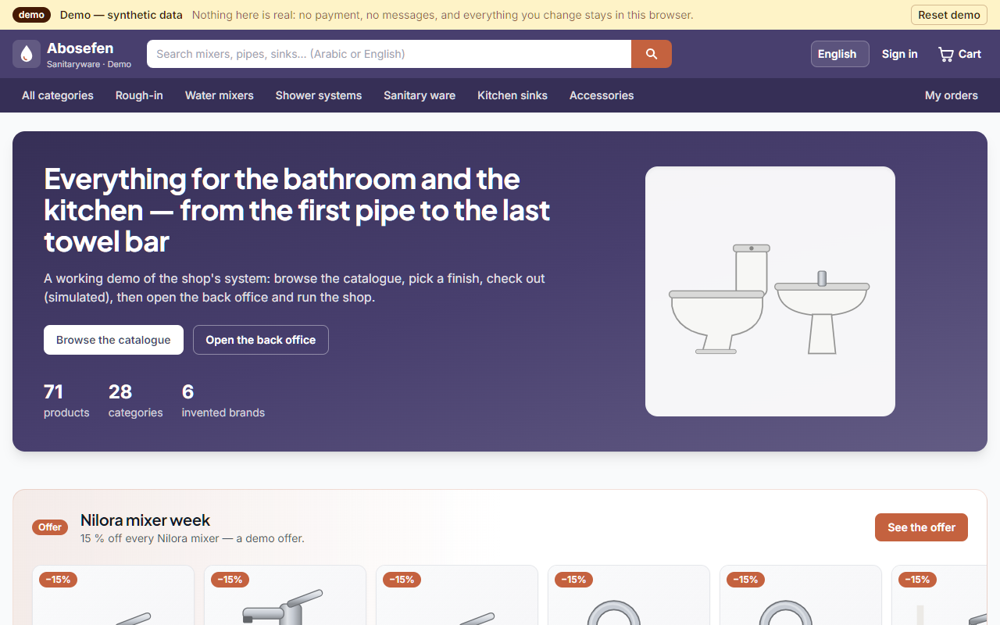
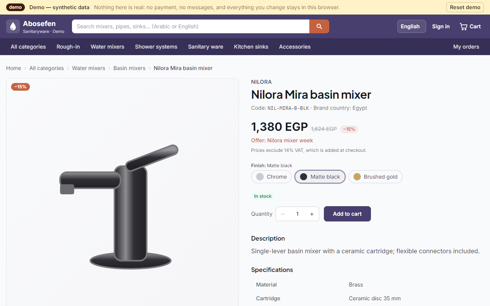
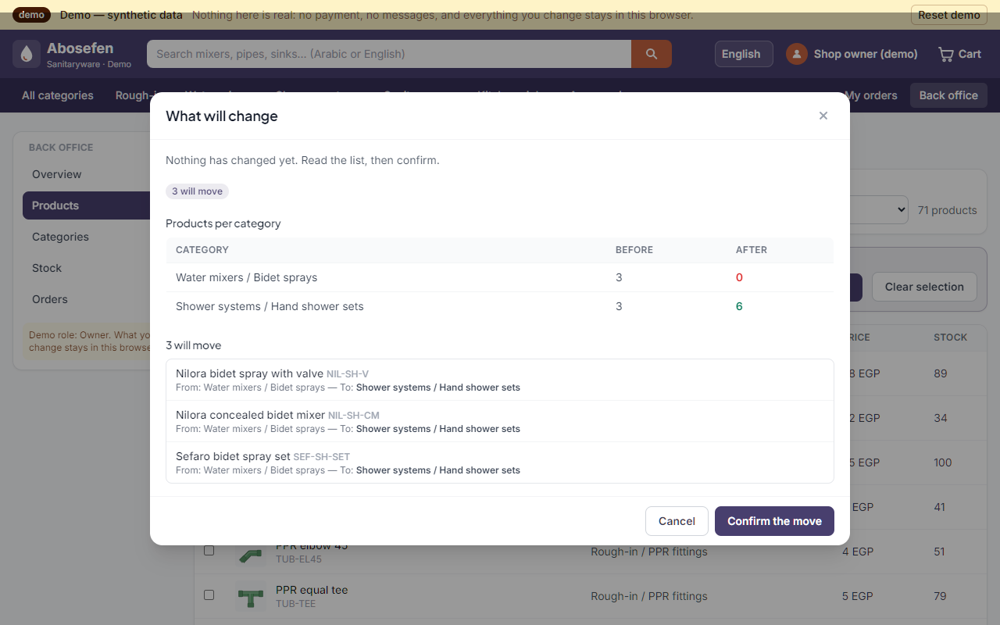
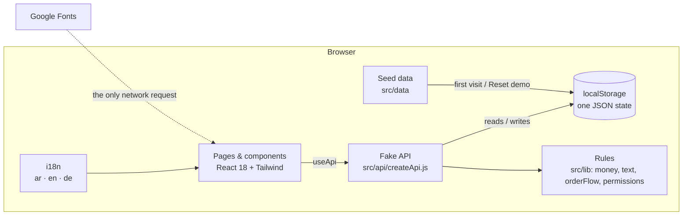

# Abosefen — Demo

[](https://github.com/OWNER/abosefen-demo/actions/workflows/ci.yml)
[](https://github.com/OWNER/abosefen-demo/actions/workflows/pages.yml)

A standalone, public demo of the **Abosefen** system — the online shop and back office of an Egyptian
sanitaryware store (pipes and fittings, valves, mixers, showers, sanitary ceramics, kitchen sinks, accessories).

It runs **entirely in the browser**: no server, no database, no account to create. Every product, brand, price,
stock figure, order and person in it is **synthetic**. Nothing you do here is real — no payment is taken, no message
is sent, and every change stays in your own browser until you press **Reset demo**.

> **Live demo:** `https://OWNER.github.io/abosefen-demo/` — *placeholder until GitHub Pages is switched on (see «Deployment»).*

The production system it is based on is a separate, private repository (.NET microservices + React). This repository
contains no production code, data, photo or secret; see [docs/SYNC.md](docs/SYNC.md) for what is shared and how.

| Storefront | Product with finishes | Back office |
|---|---|---|
|  |  |  |

*Screenshot placeholders — add the images under `docs/screenshots/` after the first deployment.*

---

## What you can try — six short walkthroughs

1. **Search the way customers type.** Search `قاعده` (written without the final ة) or `احواض` (without the hamza):
   the results are the same as for `قاعدة` / `أحواض`. `mixer`, `tap` and `خلاط` find the same products.
2. **Pick a finish.** Open *Nilora Mira basin mixer* and switch Chrome → Matte black → Brushed gold: the drawing,
   the code (`NIL-MIRA-B-BLK`), the price and the stock follow the choice. The 15 % «Nilora mixer week» offer is
   applied automatically.
3. **Check out (simulated).** Add a few items, apply the coupon `DEMO10` and watch VAT 14 % being charged on the
   amount *after* the discount. The checkout is clearly labelled *Simulation — no real payment*; no card is asked
   for. You land on the order page with its status timeline — press *Simulate the next step* to play the shop's part.
4. **Move products between categories, with a preview.** Sign in as `owner@demo`, open *Back office → Products*,
   tick a few products, choose a target and press *Preview the move*: you see exactly which products move, from
   where to where, and how many products each category will hold — before anything changes. Try a category that has
   sub-categories as the target: the move is refused (products stand on final categories only).
5. **Record a stock movement.** *Back office → Stock*: receive goods into the main warehouse, transfer to the
   showroom, take out, or correct after a count. A warehouse can never go below zero; sets have no stock of their own
   (they are counted from their parts). Every movement lands in the movement log.
6. **Work as the cashier.** Sign in as `cashier@demo`: only *Orders* is open (the other screens are refused by the
   API, not just hidden). Move an order along its road — Confirmed → Preparing → Packed → Shipped → Delivered;
   cancelling puts the goods back on the shelf.

## Demo accounts

There are no passwords. The sign-in page lists three roles; picking one only decides what you may do in this browser.

| Account | Role | Can open |
|---|---|---|
| `owner@demo` | Owner | Everything: products (with bulk move), categories, stock, orders, activity log |
| `cashier@demo` | Cashier | Orders only |
| `customer@demo` | Customer | The shop and «My orders» (three sample orders) |

Visitors who do not sign in can still browse and place a (simulated) order as a guest.

## Simulated vs. real

| Capability | In this demo | Notes |
|---|---|---|
| Catalogue, category tree, breadcrumbs | **Implemented** | 71 synthetic products, 28 categories, 6 invented brands |
| Search (Arabic letter variants, synonyms, codes) | **Implemented** | Same folding rules as production's search; a small synonym list instead of the learned vocabulary |
| Product variants (finish, size) with own price and stock | **Implemented** | |
| Sets (bundles) priced below their parts, stock from parts | **Implemented** | |
| Promotion and coupon | **Implemented** | One promotion, one coupon (`DEMO10`) |
| Cart totals — VAT 14 % on (subtotal − discount), delivery fee | **Implemented** | Same rule as production invoices |
| Checkout and payment | **Simulated** | No payment provider, no card form, nothing charged |
| Order placement, stock deduction, cancel/return restock | **Implemented** (in the browser) | |
| Order status timeline | **Implemented** | «Simulate the next step» plays the shop's part |
| E-mails / SMS / WhatsApp notifications | **Not included** | Nothing is ever sent |
| Sign-in and roles | **Simulated** | Role picker, no passwords; roles are enforced by the fake API |
| Back office: products + bulk move with preview | **Implemented** | Preview is tied to what was shown; a stale preview is refused |
| Back office: category tree (add / rename / move) | **Implemented** | Rules: final categories only, no loops, no duplicate names |
| Back office: stock per warehouse, movements | **Implemented** | Receive, issue, transfer, count correction; never below zero |
| Back office: orders and status changes | **Implemented** | Only the allowed next statuses are offered |
| Accounting, invoices, e-invoicing, payroll, suppliers, delivery drivers | **Not included** | Exist in production; out of the demo's scope |
| Product photos | **Replaced** | Drawn SVG illustrations; no manufacturer picture is used |
| Server, database, message bus | **Replaced** | An in-browser fake API with simulated latency; data in `localStorage` |

## Run it locally

Requirements: Node.js 20+ and npm.

```bash
npm ci            # install
npm run dev       # http://localhost:5173
npm test          # unit + page smoke tests (Vitest)
npm run build     # static site in dist/
npm run preview   # serve the built site locally
```

No environment variable, key or account is needed.

## Architecture



- **Pages** never touch the data directly; they call the fake API, exactly as the production frontend calls its
  REST gateway. Every API method waits 150–450 ms (instant in tests) and returns a copy.
- **The fake API** answers in the shapes the production frontend reads (see `contracts/shapes.json`), checks roles
  like a server would, and keeps one JSON state in `localStorage`. Changing the seed version re-seeds old browsers.
- **Rules** are small, pure modules shared by the API, the pages and the tests: money (VAT), search folding, the
  order road, role permissions.
- **Routing** uses `HashRouter` and a relative `base`, so the same build works on GitHub Pages or from any folder.
- **Languages:** Arabic (default, right-to-left), English and German. Every visible word comes from
  `src/i18n/{ar,en,de}.json`; the Cairo font is used for Arabic, Inter / Plus Jakarta Sans for Latin text.
- **No network:** the built page carries a Content-Security-Policy that only allows itself and Google Fonts;
  `tests/no-network.test.js` guards the code.

```
src/
  api/          fake API (createApi.js) and the app's instance
  data/         synthetic catalogue (catalog.js) and starting state (seed.js)
  lib/          rules: money, text (search), orderFlow, permissions, errorText
  i18n/         ar.json, en.json, de.json and the provider
  components/   layout, product card, SVG product art, order timeline, UI pieces
  pages/        storefront pages; pages/admin/ back office
contracts/      shapes.json — the versioned contract with production
scripts/        check-contracts.mjs — compares production usage with the contract
tests/          Vitest: API, rules, data guards, translations, contracts, page smoke tests
docs/           SYNC.md (sync strategy), BUILD_REPORT.md
```

## Keeping in sync with production

The demo shares only data contracts, design tokens and generic taxonomy names with production — never code,
data or secrets. `node scripts/check-contracts.mjs <path-to-production-repo>` reads the production frontend
read-only and reports fields added or removed since the snapshot. Details, limits and the review routine:
**[docs/SYNC.md](docs/SYNC.md)**.

## Tests

`npm test` runs:

- `fakeApi.test.js` — cart totals with VAT and coupon, stock checks, checkout and restock, the order road, roles
  enforced by the API, stock movements, bulk-move preview/apply/stale preview, category rules, persistence and reset;
- `money.test.js`, `text.test.js` — VAT arithmetic in piasters; Arabic letter folding, digits, synonyms, ranking;
- `catalog.test.js` — data guards (size, invented brands only, products on final categories, unique codes, no
  picture URLs);
- `i18n.test.js` — the three languages have the same keys and placeholders; every key used in code exists;
- `contracts.test.js` — what `contracts/shapes.json` says the demo serves is really served;
- `check-contracts.test.js` — the drift check against a synthetic «production» folder: exit 0 when equal, exit 1
  naming a newly used field or a missing source, exit 2 without a path;
- `no-network.test.js` — no fetch/XHR/WebSocket and no remote URL in the code; CSP allows only the fonts;
- `routes.test.jsx` — smoke renders of every storefront and back-office route, plus a full simulated checkout.

## Deployment

`.github/workflows/pages.yml` tests, builds and publishes `dist/` to GitHub Pages on every push to `main`
(no secret needed). In the repository's *Settings → Pages*, set **Source = GitHub Actions** once.
`.github/workflows/ci.yml` runs tests and the build on every push and pull request.

---

## بالعربية

**نسخة عرض مستقلة** لنظام محل أبوسيفين للأدوات الصحية: المتجر الإلكترونى ولوحة الإدارة، تعمل بالكامل داخل
المتصفح بدون سيرفر وبدون قاعدة بيانات. كل المنتجات والماركات والأسعار والمخزون والطلبات **بيانات وهمية**،
والماركات مُختلَقة. لا يتم أى دفع حقيقى ولا تُرسل أى رسالة، وكل ما تغيّره يبقى فى متصفحك حتى تضغط
«إعادة ضبط العرض».

جرّب:
- البحث بأشكال حروف مختلفة: «قاعده» تجد «قاعدة»، و«احواض» تجد «أحواض».
- اختر تشطيب الخلاط (كروم / أسود مطفى / ذهبى) وشاهد الكود والسعر والمخزون يتغيّرون.
- أتمم طلباً (محاكاة) بكوبون `DEMO10` — ضريبة القيمة المضافة 14٪ تُحسب بعد الخصم — وتابع حالة الطلب.
- ادخل كـ `owner@demo` وانقل منتجات بين الأقسام مع معاينة لما سيتغيّر قبل التنفيذ، وسجّل حركات مخزون.
- ادخل كـ `cashier@demo`: شاشة الطلبات فقط.

اللغات: العربية (الافتراضية، من اليمين لليسار)، الإنجليزية، الألمانية.
التشغيل: `npm ci` ثم `npm run dev`. الاختبارات: `npm test`.
المزامنة مع النظام الأصلى: [docs/SYNC.md](docs/SYNC.md).

---

*License: not yet chosen — all rights reserved by the owner until a license file is added.*
