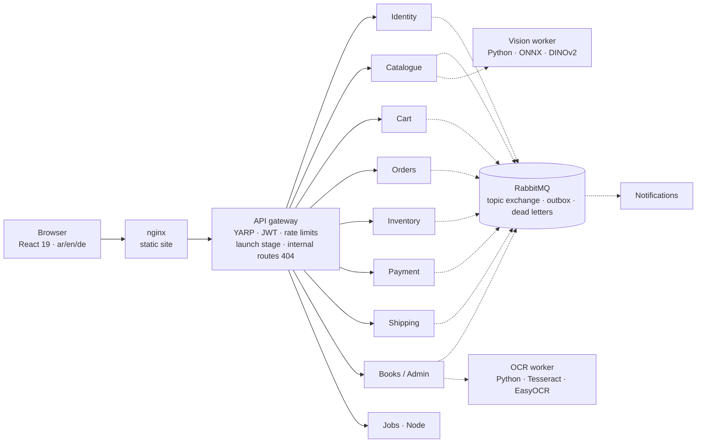

# How the production system is built

This repository holds a **standalone demo**. The system it shows runs a real sanitaryware shop in Cairo (the online
store, the counter, the warehouse and the books) and lives in a **private repository**. This document describes that
system: its shape, eight hard problems it solves, and how each solution is proved.

Every figure was counted in the private repository in October 2026, and every excerpt is shortened from one of its
files (paths are given relative to its `src/`). No data of the shop, its customers or its suppliers appears here.

The same content, in English and German, is on the demo's own page: **[How it's built](https://antoniousshehata.github.io/abosefen-demo/#/engineering)**.

**Contents:** [In numbers](#in-numbers) · [Architecture](#architecture) · [Case studies](#case-studies) ·
[How the work is done](#how-the-work-is-done) · [Technology](#technology)

---

## In numbers

| | |
|---|---|
| Back-end services behind one gateway | **10** (9 in .NET, 1 in Node) + 2 Python workers |
| C# (without generated migrations) | **≈ 103,000 lines** in 890 files |
| React front end | **≈ 68,000 lines**, 121 pages (storefront, back office, drivers) |
| Automated tests | **6,497 cases** in the unit run (22 Oct 2026): ≈ 2,400 xUnit methods (facts and theories), plus 128 Testcontainers integration tests on PostgreSQL |
| Business rules written down | **249**, of which **224** are enforced in code and name what enforces them |
| History | **1,000+ commits** since February 2026 |

---

## Architecture



- **Services.** Each .NET service has four layers (Api, Application, Domain, Infrastructure), minimal-API endpoints,
  and its own PostgreSQL 16 database with its own EF Core migrations, applied at start-up. Reports in the back office
  read the other services' databases **read-only**; they never write to them.
- **The gateway is the only door** (YARP). It validates the JWT and the permissions, limits requests per visitor,
  enforces the shop's launch stage (*closed → browse → order requests → full shop*, read from the books service every
  ten seconds, closed until the first answer), and answers 404 for every `/{service}/internal/…` route before
  anything else runs.
- **Events.** A custom RabbitMQ publisher with publisher confirms (no MassTransit), one durable topic exchange, routing
  keys `{domain}.{event}` (for example `order.order_created_event`). Services write through an **outbox**, so a change
  and its event are saved together; failed messages wait in a dead-letter exchange that an admin page can replay.
- **Identity.** HS256 JWTs; BCrypt passwords; a rotating refresh token per device, stored hashed; six roles; a `perm`
  claim of `{section}.{action}` keys over 44 sections, defined in one shared catalogue and enforced by a dynamic policy
  provider.
- **Workers.** Two Python/Flask workers, internal only: OCR for suppliers' price lists (pdfplumber, Tesseract,
  EasyOCR for Arabic) and image vectors for search by photo (DINOv2-small on ONNX Runtime, CPU).

---

## Case studies

### 1 · Money can't be booked twice

**The problem.** Two tills can pay the same supplier at the same instant, write the same cheque number, or cash a
cheque while someone else cancels it. Checks made before saving can both pass.

**How it works**
- Every save that names a supplier or a worker first takes a PostgreSQL **advisory lock** on that person
  (`pg_advisory_xact_lock(hashtextextended(<id>, 0))`), held until the transaction ends. Cancelling takes the same
  lock, so *cancel* and *cash* for one supplier run one after the other.
- Under the lock the facts are **read again**: what the supplier is still owed, whether the cheque still stands and is
  not yet cashed. If anything changed, nothing is saved.
- **Partial unique indexes** are the last wall: one cheque number while it stands, one cashing per cheque, one
  supplier invoice number per year. On a `DbUpdateException` the service reads the books again and answers with the
  real reason.
- Voucher numbers come from an `INSERT … ON CONFLICT DO UPDATE … RETURNING` counter inside the transaction: the row
  stays locked until the commit and a rollback gives the number back, so a series has no holes.

```csharp
// Admin.Infrastructure/Services/JournalVoucherService.cs
private async Task<JournalVoucher?> BuildAsync(Guid id, Figures f, JournalActor actor, DateTime now, Guid? correctsVoucherId, CancellationToken cancellationToken)
{
    if (f.PartyId is { } party)
        await LockAsync(party, cancellationToken);
    var number = await NextNumberAsync(JournalCatalog.VoucherPrefix, ShopClock.YearOf(now), cancellationToken);
    // JNL-7: what a supplier is owed is read again under his lock — of two payments at once, the second reads what
    // the first left, and a payment that is no longer within it is not saved (the reason is read again outside).
    if (f.KindName == JournalCatalog.SupplierPayment && f.KindCode == JournalCatalog.PaymentOnAccount
        && await SupplierOwedAsync(f.PartyId!.Value, id, cancellationToken) < f.Amount + f.Deducted)
        return null;
    // …and a cheque is cashed only while it stands: cancelled at the same moment (under the same lock), it is not.
    if (f.KindName == JournalCatalog.ChequeCashed && f.RelatesTo is { } paidCheque
        && (await ChequeCashingAsync(paidCheque, id, cancellationToken) is not null
            || !await _db.JournalVouchers.AsNoTracking().AnyAsync(v => v.Id == paidCheque && v.ReversedAt == null, cancellationToken)))
        return null;
    …
}
```

```csharp
// Admin.Infrastructure/Data/AdminDbContext.cs
// JNL-8: a cheque number of the shop's book is written once while it stands, and paid by the bank once.
entity.HasIndex(e => e.DocumentKey)
    .IsUnique()
    .HasDatabaseName("UX_JournalVouchers_OneChequeNumber")
    .HasFilter("\"Kind\" = 'SupplierPayment' AND \"Method\" = 'Cheque' AND \"ReversedAt\" IS NULL");
entity.HasIndex(e => e.RelatesToVoucherId)
    .IsUnique()
    .HasDatabaseName("UX_JournalVouchers_OneCashingACheque")
    .HasFilter("\"Kind\" = 'ChequeCashed' AND \"ReversedAt\" IS NULL");
```

**How it is proved.** Unit tests for each rule (`A_cancelled_cheque_is_never_cashed`,
`A_cashed_cheque_is_cancelled_only_after_its_cashing_and_then_he_is_owed_again`,
`A_named_suppliers_invoice_number_is_recorded_once`, …). The unit tests run on EF Core's in-memory provider, where
an advisory lock does nothing and partial indexes are not enforced — so the races are proved by a **rehearsal script**
against a copy of the real PostgreSQL database, with the service on its own port and the message bus closed:

```js
// tools/journal-rehearsal/walk-6.mjs — a cheque cancelled and cashed at the same instant: never both
for (let round = 1; round <= 3; round += 1) {
  const c = await record(cashier, { kind: 'SupplierPayment', amount: 20, method: 'Cheque', partyId: A.id, documentNumber: `${stamp}${round}`, dueDate: inTen });
  const [cancel, cash] = await Promise.all([
    call(manager, 'POST', `/admin/journal/vouchers/${c.data.id}/reverse`, { reason: 'تجربة — سباق' }),
    record(cashier, { kind: 'ChequeCashed', amount: 20, method: null, chequeId: c.data.id }),
  ]);
  check(`round ${round}: cancelled and cashed at once → never both`, !(cancel.status === 200 && cash.status === 201));
}
```

### 2 · Closing a month without stopping the shop

**The problem.** Once a month's VAT return is filed, nothing may be dated into it. But a month could close between a
save reading the calendar and committing, and events that arrive late still need a home.

**How it works**
- One calendar key (`0x4C44_4752_434C_4E44`, "LDGRCLND"). Every posting holds it **shared**
  (`pg_advisory_xact_lock_shared`); closing or reopening a month holds it **exclusively**. No month closes between a
  save's read and its commit. The poster opens its own transaction when the caller has none.
- An entry typed **by hand** into a closed month is refused. An entry a **service** reports late is booked at **noon**
  of the first open day — midnight in Cairo is still the previous day in UTC, where the reports cut the day — and keeps
  its document's own date (`DocumentDate`), by which debts are aged.
- Months close in an unbroken run; only the last one can be reopened, with a reason. A partial unique index allows one
  closing in force per month; both actions write an audit note.

```csharp
// Admin.Infrastructure/Services/JournalPosterService.cs
await using var own = await _ledgerRepository.BeginOwnTransactionAsync(cancellationToken);
await _ledgerRepository.HoldCalendarAsync(exclusive: false, cancellationToken);
if (await _ledgerRepository.GetFirstOpenDayAsync(cancellationToken) is { } firstOpen
    && ShopClock.DayOf(entry.EntryDate) < firstOpen)
{
    if (JournalCatalog.IsByHand(entry.Source))
        return Result<JournalEntry>.Failure(JournalCatalog.MonthClosed);
    entry.DocumentDate ??= entry.EntryDate;
    entry.EntryDate = ShopClock.StartOf(firstOpen).AddHours(12);
}
```

**How it is proved.** `A_month_is_closed_by_the_owner_only_after_it_ends_and_one_after_the_other`,
`Nothing_is_recorded_by_hand_into_a_closed_month`,
`A_system_entry_dated_in_a_closed_month_is_booked_on_the_first_open_day_and_keeps_its_own_date`,
`What_is_owed_is_aged_by_the_papers_own_date_when_it_was_booked_late`.

### 3 · One reader, one door

**The problem.** A supplier once had three different balances — the catalogue's, the payables page's and the books' —
and two places where a payment could be typed, so one instalment could be recorded twice.

**How it works**
- Balance, statement and payables ageing are all read from **one place**: the ledger lines on Accounts Payable tagged
  with that supplier. A cancelled voucher and its mirror entry drop out together; payments are taken off the oldest
  debt first.
- The old payment endpoint of the catalogue service now answers **410 Gone** and says where to go; the day-book is the
  only door.
- Stock follows the same idea: goods leave the shelf only when an order's **reservation is confirmed**. Every sale path
  goes through it, and confirming twice deducts once.

```csharp
// Catalog.Api/Endpoints/SupplierEndpoints.cs
// JNL-7: a supplier's money has ONE door — a voucher of the day-book (Admin) — and ONE reader, his lines in the
// books. This door took any amount, with no place, no day and no undo, beside the day-book's: one instalment
// could be typed twice. It is closed and says where to go; the rows it wrote stay as history.
group.MapPost("{id:guid}/payments", () => Results.Json(
        new { success = false, error = SupplierPaymentMoved }, statusCode: StatusCodes.Status410Gone))
    .RequireAuthorization("perm:suppliers.edit");
```

**How it is proved.** A guard test (`SupplierMoneyHasOneDoorTests`) fails the build if the catalogue's service gets a
payment method back, if the old route stops answering 410, or if any front-end file reads the catalogue's own balance
again. `His_balance_his_statement_and_the_payables_aging_read_his_tagged_lines_only`; for stock,
`Asking_twice_deducts_once`. (The single stock deductor is held by behaviour tests and code review; there is no
source-scanning guard for it yet.)

### 4 · A decision is tied to what was read

**The problem.** A customer can edit a review while the shop is pressing *Publish*. Without a guard, words nobody in
the shop had read would go live.

**How it works**
- Every review carries a `Revision` that goes up with every edit and every decision. EF Core uses it as a
  **concurrency token**, so `UPDATE … WHERE "Revision" = @read` refuses a save made on an older read.
- The publish request must carry the revision the screen showed; a different one is answered **409**,
  *changed since you read it*. A race in the middle of the save is caught as `DbUpdateConcurrencyException`.
- A writer's edit that crosses a decision is applied on top of it and goes back to waiting.

```csharp
// Catalog.Infrastructure/Services/ReviewService.cs
// The decision is about the words the panel showed. Other words now: nothing is decided.
if (review.Revision != revision)
    return Result<ModeratedReviewResponse>.Conflict(ReviewRules.ChangedSinceRead);

review.IsApproved = isApproved;
review.ModeratedAt = now;
review.Revision++;
try
{
    await _context.SaveChangesAsync(cancellationToken);
}
catch (DbUpdateConcurrencyException)
{
    // Its writer changed it (or took it back) while the decision was on its way.
    return Result<ModeratedReviewResponse>.Conflict(ReviewRules.ChangedSinceRead);
}
```

**How it is proved.** The tests slip a second database context in during the save:
`A_publish_of_words_the_shop_did_not_read_is_refused`,
`A_decision_on_its_way_while_the_writer_changes_the_words_is_refused`,
`Two_decisions_at_once_are_one_decision_and_the_second_is_asked_to_read_again`.

### 5 · An audit log that can't publish a refused change

**The problem.** The audit record used to be saved through the request's own database context — which could still hold
a change the endpoint had just refused (and answered 400). Saving the audit row would have saved that change too. A
code review caught it.

**How it works**
- The audit record is written in a **database scope of its own**, through the outbox — never the request's. An
  endpoint that throws is still recorded, as a 500, and the exception still reaches the caller.
- Only **changes** are recorded. A question asked with POST (a count, a preview, a search by photo) is marked
  `.NotAudited()`; a dry run marks itself *only asked*. In the catalogue only staff actions are recorded, never a
  customer's own clicks.
- A bulk change leaves a **note** of numbers, yes/no values, ids and short identifiers only — a sentence or a typed
  name is dropped, so the log never repeats personal data.

```csharp
// Shared.Infrastructure/Middleware/HttpAuditPublishMiddleware.cs
if (!MutatingMethods.Contains(context.Request.Method)) return;
if (context.User?.Identity?.IsAuthenticated != true) return;
// a question asked by POST (a count, a preview) is not a change
if (context.GetEndpoint()?.Metadata.GetMetadata<Http.NotAuditedAttribute>() is not null) return;
if (Http.AuditNote.WasOnlyAsked(context)) return;
…
await using var scope = context.RequestServices.GetRequiredService<IServiceScopeFactory>().CreateAsyncScope();
await scope.ServiceProvider.GetRequiredService<IOutboxPublisher>().PublishAsync(record);
```

```csharp
// Shared.Infrastructure/Http/AuditNote.cs
/// A figure, a yes / no, an id, or a short identifier in plain letters (a table's name). Anything else — a sentence,
/// a name somebody typed — is left out: the log is read by people who were not there.
private static object? Figure(object? value) => value switch
{
    null or bool or Guid or sbyte or byte or short or ushort or int or uint or long or ulong or decimal or double or float => value,
    string text when text.Length is > 0 and <= 80 && text.All(c => c < 128 && (char.IsLetterOrDigit(c) || c is '_' or '-' or '.' or ':')) => text,
    _ => null,
};
```

**How it is proved.** `AuditWritesInItsOwnScopeTests` calls an endpoint that adds a row and answers 400: afterwards
the row is not in the database and exactly one audit event is in the outbox — for each of the three writers. A fifth
test reads every `src/**/*.cs` and fails the build if any middleware's `InvokeAsync(HttpContext, …)` is handed a
`DbContext`, an `IOutboxPublisher` or an `IOutboxDbContext`.

### 6 · Search the way Egyptians type

**The problem.** Shoppers mix alef and hamza forms, ة and ه, ى and ي, Arabic-Indic digits, trade slang and half-typed
words. Exact matching found nothing: «بان» returned no results instead of bathtubs.

**How it works**
- **One fold function, written twice** — in C# and as the PostgreSQL function `abosefen_fold` (`IMMUTABLE PARALLEL
  SAFE`) — so the database and the app agree on every letter. Products carry a folded search text kept current by
  triggers.
- **A short word being typed.** A word of three letters or fewer must normally stand alone («دش» is not found inside a
  longer word). But one the catalogue never holds whole, while some of its words begin with it, is read as the start
  of a word: «بان» finds بانيو, never a word with «بان» in the middle. The same regular expression runs in the database
  and in .NET.
- **Typos** are corrected towards real catalogue words by bounded edit distance; *did you mean* uses `pg_trgm`
  similarity against past successful searches.
- **The search learns.** Every query is counted; searches with no result show the shop what customers ask for and it
  does not stock; an accepted *did you mean* becomes a synonym; the owner can teach word pairs («باتيري» = «خلاط»).

```csharp
// Shared.Contracts/Common/Search/SearchFold.cs
var c = raw switch
{
    'أ' or 'إ' or 'آ' or 'ٱ' => 'ا',
    'ى' => 'ي',
    'ة' => 'ه',
    'ؤ' => 'و',
    'ئ' => 'ي',
    '٫' => '.',
    >= '٠' and <= '٩' => (char)('0' + (raw - '٠')),
    >= '۰' and <= '۹' => (char)('0' + (raw - '۰')),
    _ => raw,
};
if (c == 'ـ' || (c >= 'ً' && c <= 'ٟ') || c == 'ٰ') continue; // tatweel, harakat
```

```csharp
// Catalog.Infrastructure/Search/ProductSearchEngine.cs
private static SearchTerm StartOfAWord(SearchTerm term, ProductSearchVocabulary.Snapshot snap)
{
    if (term.Kind != SearchTermKind.Word || term.Meaning != null || snap.Words.Count == 0) return term;
    var shortOnes = term.WholeWordVariants.ToList();
    if (shortOnes.Count == 0 || shortOnes.Count != term.Variants.Count) return term;
    if (shortOnes.Any(snap.Words.ContainsKey)) return term;
    return snap.Words.Keys.Any(k => shortOnes.Any(v => k.Length > v.Length && k.StartsWith(v, StringComparison.Ordinal)))
        ? term with { WordStart = true }
        : term;
}
```

**How it is proved.** `SearchWordStartTests` (a short start finds the word and its forms with ال/بال; never mid-word;
a short word held whole stays whole; and the database's own pattern gives the same answer), `SmartSearchTests`,
`SearchRankingTests`, and a measuring tool that runs the shop's real searches before a release.

**Related — reading a product like a merchant.** A `ProductReader` reads a product's name as four small decisions
(kind, material, colour, joint), each rated *sure*, *likely* or *unsure*, and proposes a category by the narrowest
matching rule. Anything unsure goes to the owner; nothing is moved on its own. What he teaches overrides the built-in
knowledge, and a later lesson that would contradict one of his decisions is refused.

### 7 · Search by photo with no paid AI

**The problem.** Customers wanted to photograph a part and find it — without a cloud AI bill, without API keys,
without storing their photos, and on the same small server that runs the shop.

**How it works**
- A Python worker runs **DINOv2-small as ONNX on the CPU** (the model is baked into the image and checked against a
  pinned SHA-256). Every picture is put whole on a white square — never cropped — and becomes an L2-normalised vector
  of 384 numbers. The model was chosen by measuring it against CLIP B/32 and a centre crop on the shop's own photos.
- A background service reads every catalogue picture in small batches (with pauses, so the live site stays fast) and
  stores the vectors per model; the in-memory library is an immutable snapshot swapped without locks.
- A search is a brute-force **SIMD dot product** over the whole library — at this size a few milliseconds, so no
  vector database. Hidden products are removed **before** ranking; a likeness floor keeps only close matches; the
  results pass the same gate as text search.
- The photo comes from the camera or the gallery only, is judged by its magic bytes (JPEG, PNG, WebP), is never written
  to disk, and the gateway limits searches per visitor.

```python
# tools/vision-worker/app.py
def prepare(im):
    """The WHOLE picture on a white square (never cropped: a tall shower column keeps its head and its foot)."""
    width, height = im.size
    side = max(width, height)
    square = Image.new("RGB", (side, side), (255, 255, 255))
    square.paste(im, ((side - width) // 2, (side - height) // 2))
    square = square.resize((SIDE, SIDE), Image.BICUBIC)
    pixels = (np.asarray(square, dtype=np.float32) / 255.0 - MEAN) / STD
    return pixels.transpose(2, 0, 1)

def vectors_of(prepared):
    batch = np.stack(prepared)
    last_layer = _session.run(None, {_input: batch})[0]
    out = last_layer[:, 0, :].astype(np.float32)
    out /= np.linalg.norm(out, axis=1, keepdims=True) + 1e-12
    return out
```

```csharp
// Catalog.Infrastructure/Search/Photo/PhotoLibrary.cs
for (var row = 0; row < _urls.Length; row++)
{
    var likeness = Dot(_numbers.AsSpan(row * Dimensions, Dimensions), photo);
    if (likeness < minLikeness) continue;
    foreach (var product in _products[row])
    {
        if (allowed is not null && !allowed.Contains(product)) continue;
        if (!best.TryGetValue(product, out var held) || likeness > held.Likeness)
            best[product] = (likeness, row);
    }
}
```

**How it is proved.** `PhotoSearchTests` (17 tests: hidden products never appear, vectors of another model find
nothing, a file is judged by its bytes whatever its name, technical drawings are never matched, an unreadable picture
is retried a day later, the library is rebuilt only when it would differ) and `PhotoLibraryPostgresIntegrationTests`.

### 8 · Rules the code enforces — and changes rehearsed before they ship

**The problem.** The owner's business rules lived in conversations. A rule that lives only in someone's head is broken
by the next change, and a money bug found after release is found by a customer.

**How it works**
- **249 rules are written down** (`docs/BUSINESS_RULES.md` in the private repository), each with what enforces it:

  ```markdown
  ### CAT-1 · Leaf-only products ✅
  A product's category must be a leaf (no child categories). A category with sub-categories
  is a navigation container; its counts roll up from its leaves, so it must never hold a product directly.
  - Enforced: ProductService.CreateAsync / UpdateAsync reject a non-leaf CategoryId
    (CatalogRules.LeafOnlyCategory); auto-classification refuses a non-leaf.
  ```

- **Guard tests read the code itself**, for example: only one service may write stock balances and movements
  (`StockChangesGoThroughOneDoorTests`); every message a service sends exists in Arabic, English and German
  (`ServerMessagesLanguageTests`); features not yet proven may not default to *on* in any compose file
  (`SwitchedOffFeaturesStayOffTests`); a hosted service may end only on its own stopping token
  (`BackgroundServiceSurvivalTests`). The front end has audits of its own: no text outside the translation files, a
  paged grid always asks for whole rows, staff never type the English or German by hand, one product card everywhere.
- **Six gates** for any change to money, stock or the books: agreed first against the written rules; a test that fails
  before the change; an independent review from five directions (accountant, warehouse, reports, software, document
  cycle) filed with the change; a rehearsal on a copy of the data; a walk through the screens in Arabic on phone and
  desktop; and a **books check** after the deploy — a read-only SQL script in which every line must read 0 (entries in
  balance, no holes in numbered series, every supplier line carries its supplier, issued cheques match their account,
  nothing dated into a closed month, …).
- **Deploys** are built from a `git archive` of one commit with LF line endings — never the working folder — checking
  that every committed file arrived; every image is labelled with its commit, and a final check lists any service still
  running older code.

**How it is proved — the gates catch real faults.** On 14 October 2026, for the release of supplier cheques: the
review found a cheque that could be cashed while it was being cancelled (its state was read outside the supplier's
lock), and the books check on the rehearsal copy found a supplier's opening balance in the shop's favour not counted.
Both were fixed, each with a test, before release.

---

## How the work is done

- **How AI is used.** I own the product: the requirements, the 249 business rules, the priorities, the reviews on
  screen and every release decision. AI pair-programming (Claude Code) writes and checks code under that direction,
  the way modern teams work — and the guardrails described above (written rules, guard tests, six gates, rehearsals on
  a copy of the data) are how its work is held to the standard before anything reaches the shop.
- **Tests at three levels.** Unit tests (xUnit, FluentAssertions, Moq, EF Core in-memory), integration tests on real
  PostgreSQL and RabbitMQ in containers (Testcontainers), and rehearsals on a copy of production data for anything
  that touches money.
- **Secure by default.** Short-lived tokens, rotating per-device refresh tokens stored hashed, BCrypt, permissions per
  section and action, rate limits at the gateway, internal routes hidden. CI runs secret scanning (gitleaks), dependency
  review, `npm audit` and a NuGet vulnerability check; release images are scanned with Trivy.
- **Arabic first.** Right to left by default, three languages from translation files; audits fail the build on text
  outside them. The owner types Arabic only; the program writes the English and German, and he can correct them.
- **Built with one real shop.** The owner's words became the category tree, the rules and the search vocabulary. The
  program proposes and he decides: nothing in the catalogue is moved without his say.

## Technology

| | |
|---|---|
| Back end | .NET 10 · ASP.NET Core minimal APIs · EF Core 10 · PostgreSQL 16 · RabbitMQ · YARP · JWT |
| Front end | React 19 · Vite 6 · Tailwind CSS · React Router 7 · own i18n (ar / en / de, RTL) |
| Workers | Python · Flask · ONNX Runtime (DINOv2-small) · Tesseract · EasyOCR |
| Quality and delivery | xUnit · FluentAssertions · Moq · Testcontainers · GitHub Actions · gitleaks · Trivy · Docker |

---

Designed, directed and shipped by Antonious Shehata — built with AI-assisted development. © 2026.
